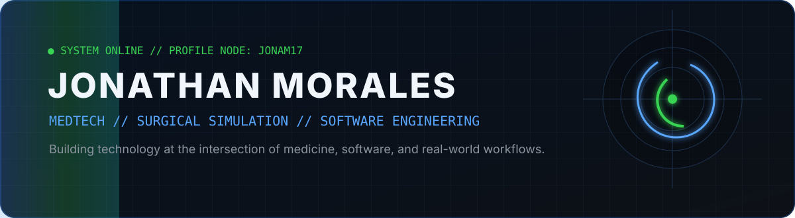

  
    
  
  

## Hi, I'm Jonathan 👋

I build software for **surgical simulation and biomedical research**: inventory systems, dose-support tools, and workflow platforms for people who work in labs and operating-room environments.

My background in biomedical research means I start from the **real workflow, the real user, and the real constraint** (a tablet in a lab, spotty connectivity, a supply that can't run out) and work back to the code.

## 🧪 What I'm building

| Project | What it does | Stack | Status |
|---|---|---|---|
| **SIMS** — Suture Inventory Management System | Gives surgical simulation teams live visibility into suture stock | Next.js · React · FastAPI · PostgreSQL | 🟢 Active development |
| **CFS Inventory Reorder** | Supply tracking and a single reorder workflow, built for iPad use | Next.js · FastAPI · PostgreSQL | 🟢 Active |
| **Porcine Anesthesia Calculator** | Offline-first medication and dose support for research models | Offline-first · Healthcare · Research | 🟡 In development |
| **Surgical Simulation Tech** | Connecting physical hardware, data, and AI in simulation workflows | Raspberry Pi · Python · Robotics | 🔵 Exploring |

## 🛠️ Toolkit

| | |
|---|---|
| **Languages** | `Python` `TypeScript` `JavaScript` `SQL` |
| **Application** | `Next.js` `React` `FastAPI` `Node.js` |
| **Data & infra** | `PostgreSQL` `Git` `GitHub Actions` `Vercel` |
| **Hardware & systems** | `Raspberry Pi` `Linux` `REST APIs` |

## 🧭 How I work

- **Solve real problems.** Talk to the people doing the work before writing code.
- **Design for humans.** If it needs a manual, it isn't finished.
- **Build for reliability.** Clinical and research settings don't tolerate flaky tools.
- **Keep learning.** Currently exploring robotics, AI, and data for simulation.

## 📈 Activity

  <picture>
    <source media="(prefers-color-scheme: dark)" srcset="https://raw.githubusercontent.com/jonam17/jonam17/output/github-contribution-grid-snake-dark.svg">
    <source media="(prefers-color-scheme: light)" srcset="https://raw.githubusercontent.com/jonam17/jonam17/output/github-contribution-grid-snake.svg">
    
  </picture>

## 🤝 Let's connect

I'm interested in work where **software leaves the screen and affects the real world**: healthcare, surgical education, research automation, and robotics. If that's your problem space, open an issue on any of my repos or find me on [Stack Overflow](https://stackoverflow.com/users/jona17).

  

